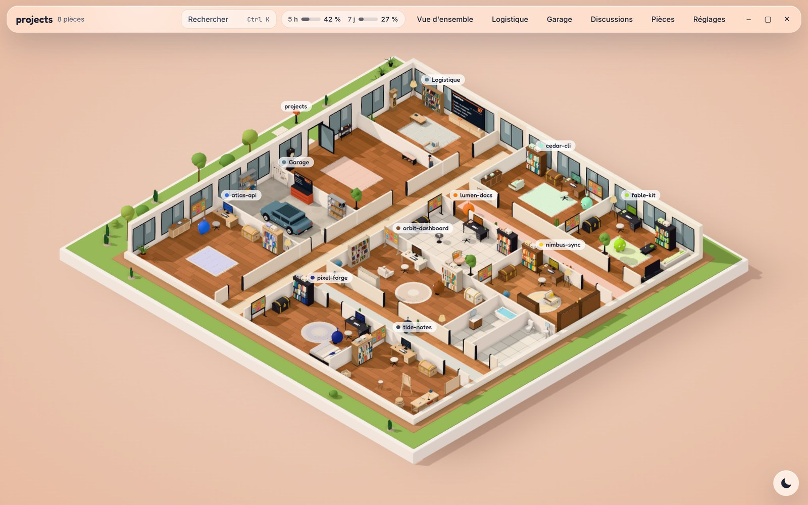
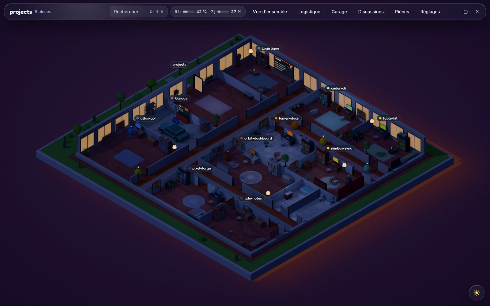
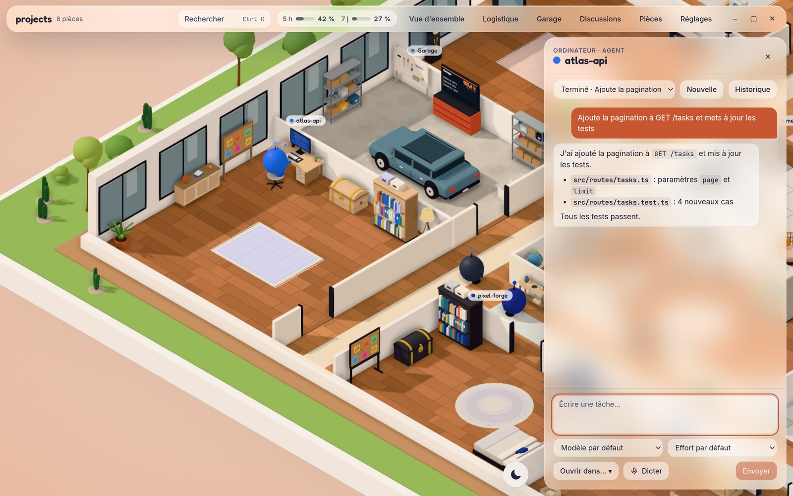
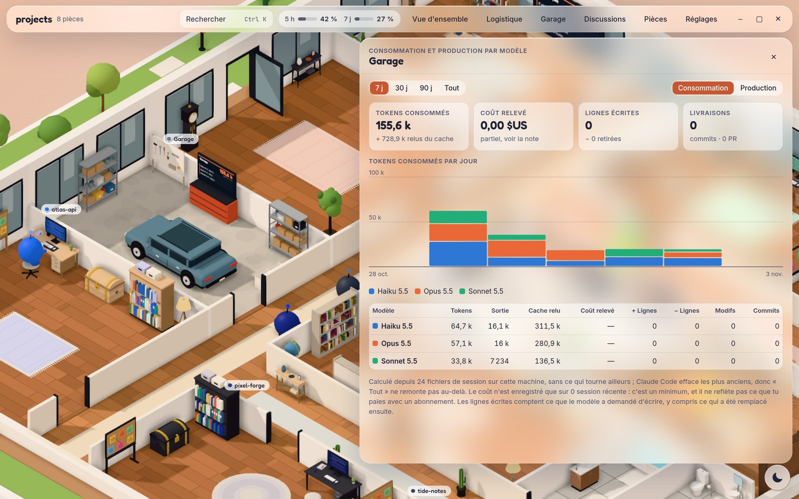
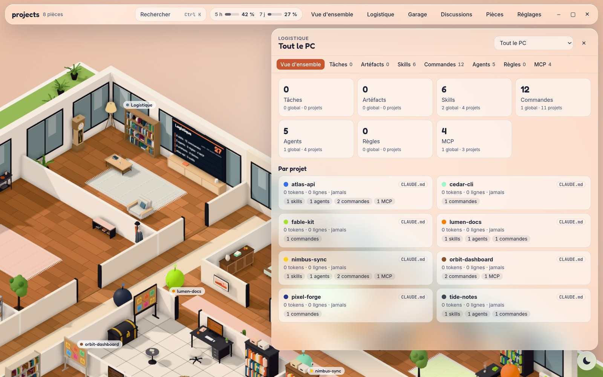
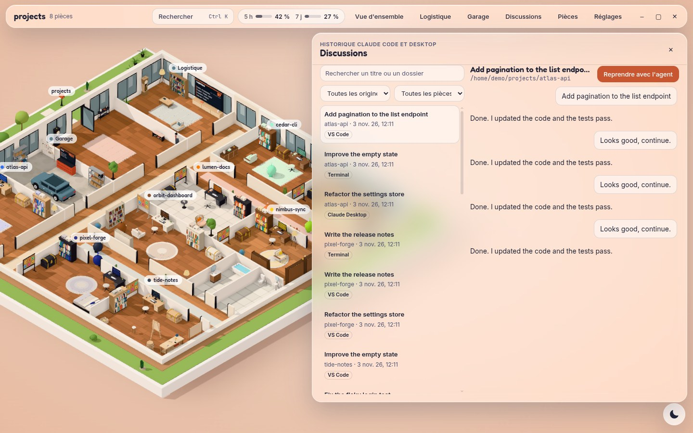
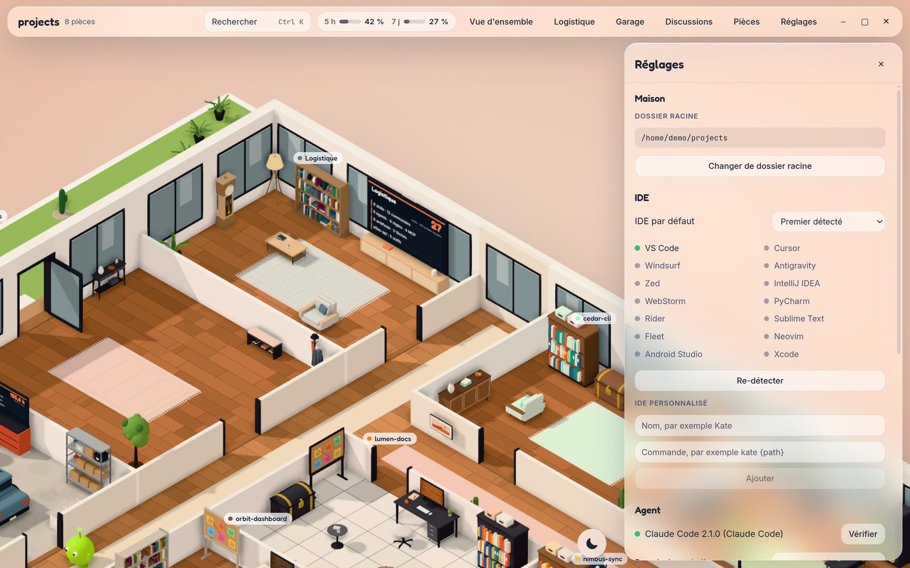

# Agents House

Electron desktop app: an isometric 3D house where each local project is a room, inhabited by a small agent that drives Claude Code in the project folder.

The interface is in French.

## Screenshots

These screenshots use sample data: the projects and conversations shown are fictional.



| | |
|---|---|
|  |  |
| **Night mode** | **Agent chat**, with model and effort selection |
|  |  |
| **Garage**: usage by model | **Logistics**: skills, commands, agents and MCP servers |
|  |  |
| **Conversations**: past Claude Code and Claude Desktop sessions | **Settings** |

## Install on Ubuntu

```bash
wget -qO- https://raw.githubusercontent.com/thibault60000/agents-house/main/install.sh | bash
```

The app then appears in your applications. Running the command again installs the latest version.

## Run

```bash
npm install
npm run dev
```

| Command | Purpose |
|---|---|
| `npm run dev` | Starts the app with hot reload |
| `npm run build` then `npm start` | Starts the compiled version |
| `npm test` | Procedural layout tests (Vitest) |
| `npm run typecheck` | Checks types (main, preload, renderer, Svelte) |
| `npm run dist` | Creates packages for the current OS in `release/` |

Without the `claude` CLI in your PATH, agents run in demo mode.

## Controls

Drag: pan. Mouse wheel: zoom. Double-click a room: center it. `Q` / `E`: rotate 90°. `F`: overview. `Tab` then `Enter`: browse and open objects. `Ctrl+K`: command palette.

## Structure

- `src/main`: file system, IDEs, Claude Code agents, persistence.
- `src/preload`: the only bridge to Node, exposed as `window.house`.
- `src/renderer/scene`: Three.js. `house/layout.ts` is pure and free of Three.js.
- `src/renderer/ui`: Svelte interface. The glass tokens are in `styles/tokens.css`.
- `src/shared`: shared types.

## Agent permissions

By default, tasks run with `claude -p --permission-mode acceptEdits`: the agent edits project files without asking for confirmation. The mode can be changed in the settings.
